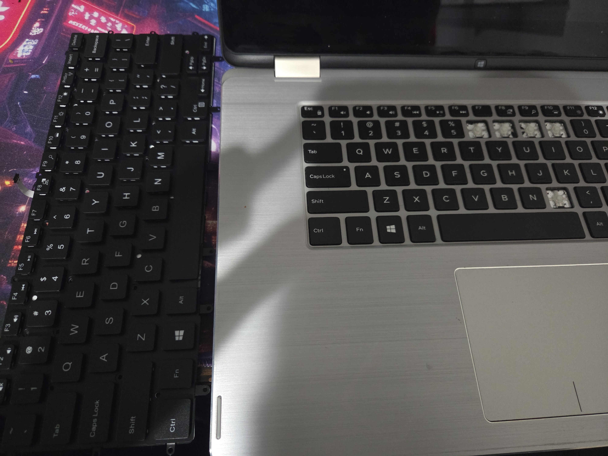

# Laptop Keyboard Replacement

## 🛠️ Overview & Preparation
* **Objective:** Replace an integrated Dell laptop keyboard requiring a full internal teardown.
* **Components:** Bottom enclosure, battery, motherboard, heatsink, fan, IO board, SSD, internal cabling and ribbon connectors, metal shielding, and keyboard module. 

  

## Step 1: Component Inspection
