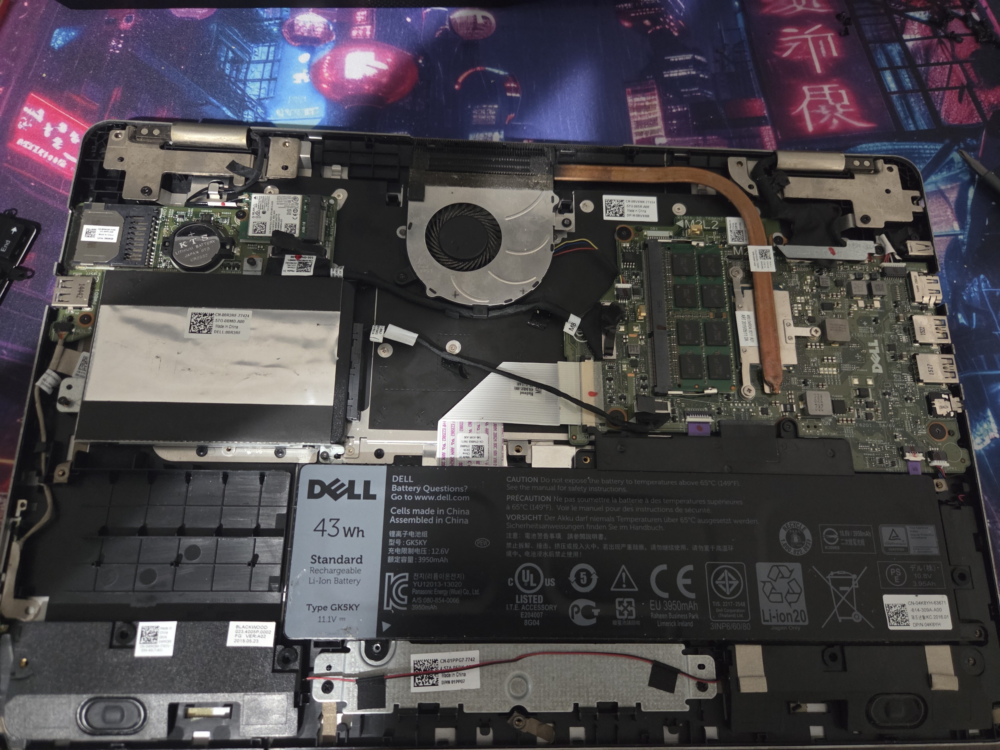
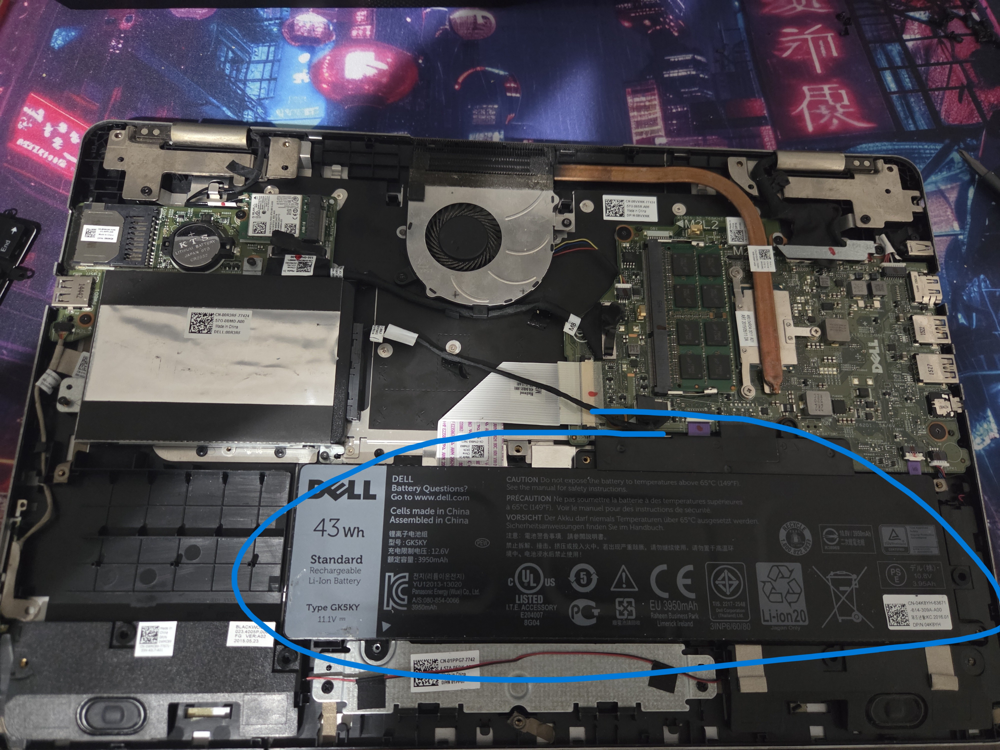
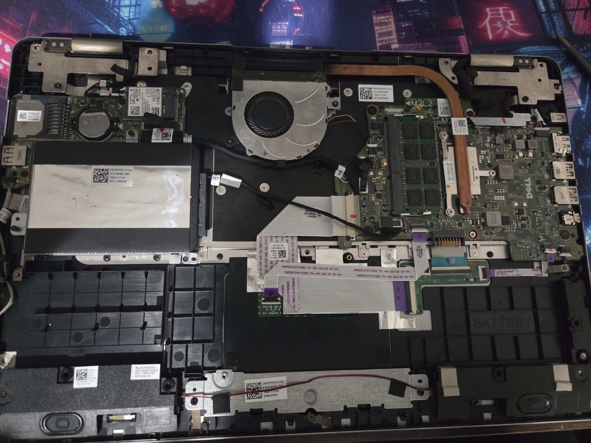
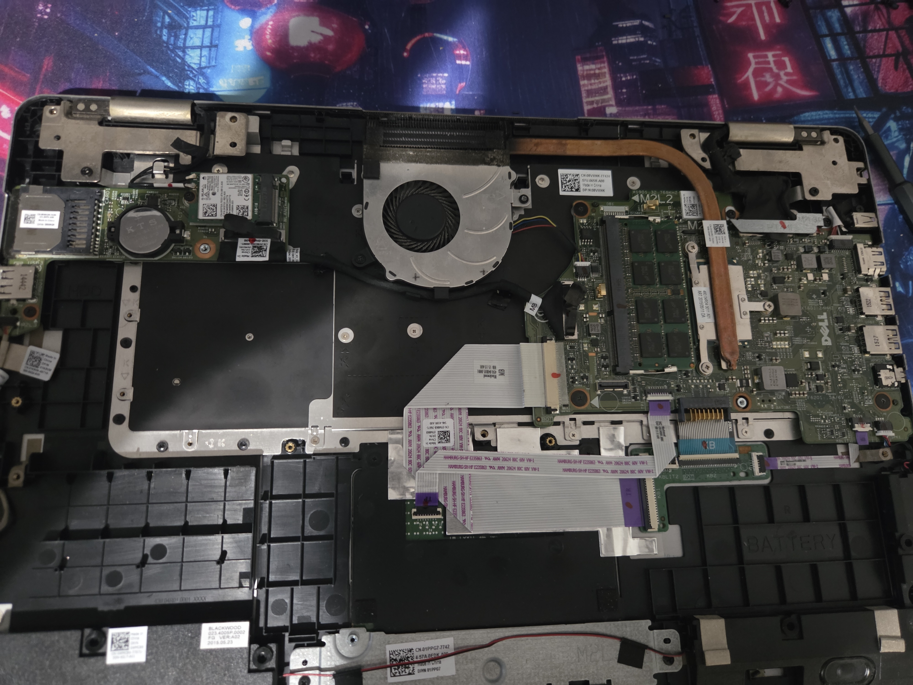
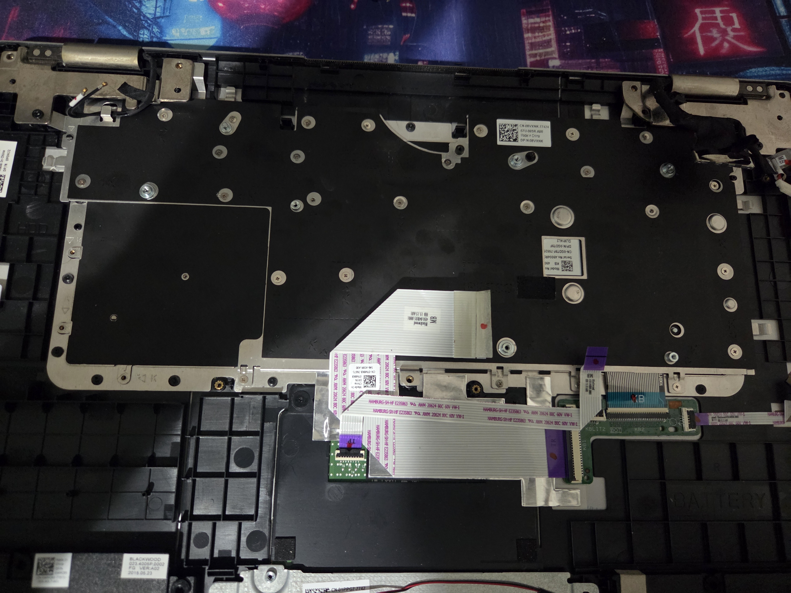
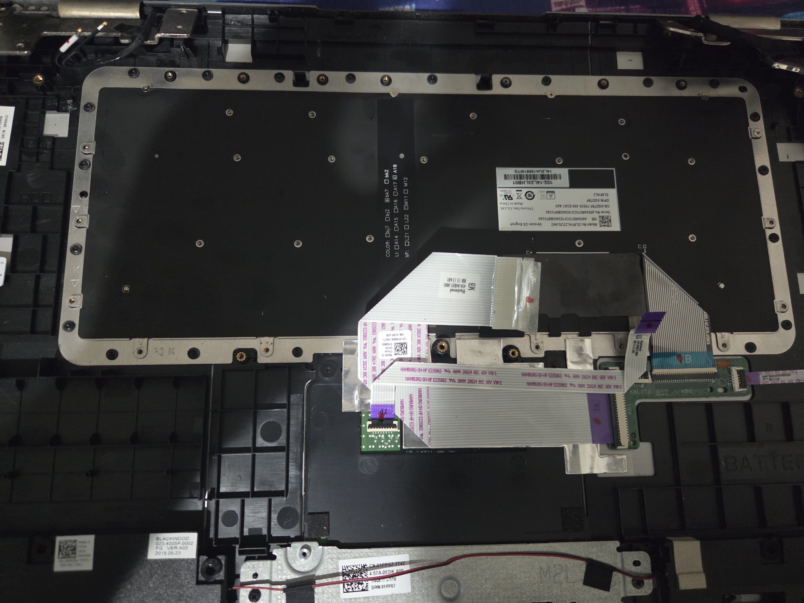
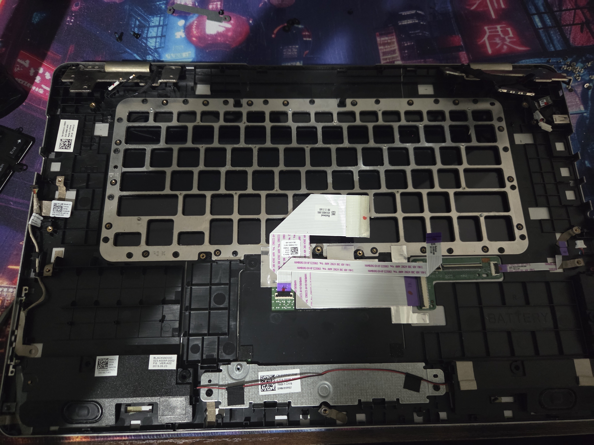
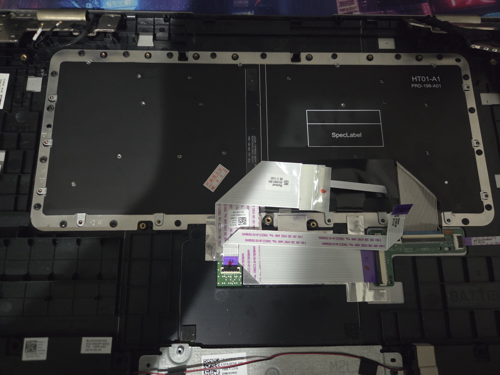
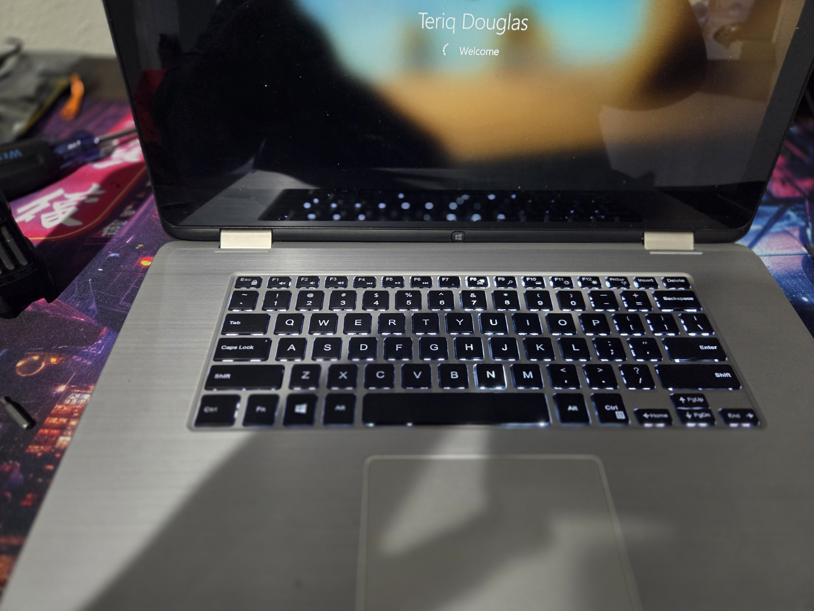

# Laptop Keyboard Replacement

## 🛠️ Overview & Preparation
* **Objective:** Replace an integrated Dell laptop keyboard requiring a full internal teardown.
* **Components:** Bottom enclosure, battery, motherboard, heatsink, fan, IO board, SSD, internal cabling and ribbon connectors, metal shielding, and keyboard module. 

  

## Step 1: Component Inspection
  * Lay out new replacement keyboard to confirm correct layout and necessary ribbon cables.
  * Power down system and disconnect power cables.

## Step 2: Remove Bottom Enclosure
  * Place laptop face down on a clean, non-scratch surface.
  * Unscrew and remove all screws securing the bottom cover to the chassis.
  * Carefully pry open and lift away cover to expose internal components.

  

## Step 3: Power Isolation
  * Locate internal battery.
  * Disconnect battery from motherboard to prevent short circuits.

  

  

## Step 4: Motherboard and Component Removal
  * Disconnect ribbon cables and pin connectors.
  * Remove motherboard, cooling fan, IO board, and hard drive.

  

  

## Step 5: Removing Old Keyboard and Installing New Keyboard
  * Unscrew and remove all screws securing the keyboard's metal shielding.
  * Lift away shielding and remove all screws securing the keyboard to the chassis.
  * Lift away old keyboard module from the frame.
  * Drop in new keyboard into the keyboard frame, ensuring all keys are fit flush in the frame.
  * Secure the module to the frame with screws, then secure the metal shielding on top.
  * Reinstall all components and reconnect all ribbon cables and pin connectors.
  * Reconnect battery and screw bottom cover back onto the chassis.
  * Power on laptop and test every key to ensure proper function.

  

  

  

  

